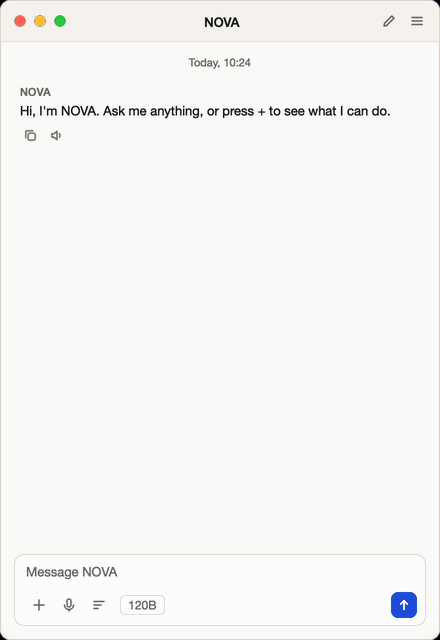
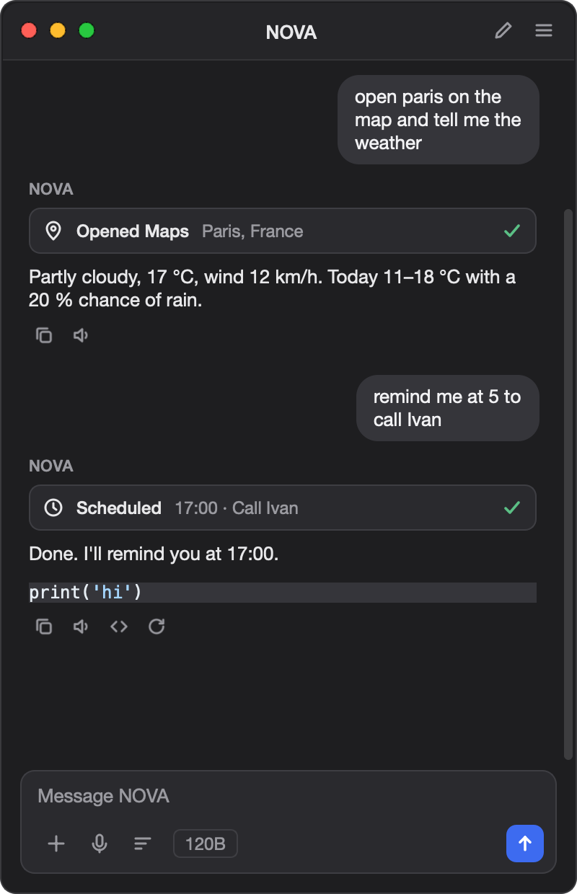
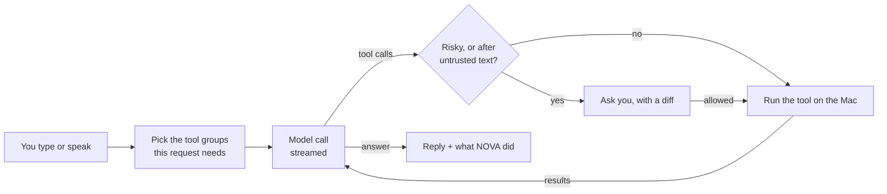

# NOVA

**An AI assistant for the Mac that does things, not just talks.** It opens apps, answers from your documents,
manages your calendar and reminders, acts on text you select in any app, and listens and speaks. It works with
Groq, Claude, OpenAI or a model running offline on your Mac, and it asks before anything risky.

**[Download NOVA for Mac](https://github.com/Martin-gif-maker/NOVA/releases/latest)** (Apple Silicon) · or run it from
source (below).

[](https://github.com/Martin-gif-maker/NOVA/actions/workflows/ci.yml)


[](LICENSE)

<p align="center">
  
  &nbsp;
  
</p>

## Highlights
* **A real agent loop.** 52 tools (apps, files, web, Calendar, Reminders, Mail drafts, Shortcuts, documents,
  schedules, screen) and any [MCP](https://modelcontextprotocol.io) tool server. The model chains them;
  NOVA's own code runs them.
* **Safe by design.** Shell, code, deleting, typing and shutting down always ask first, with a diff of what
  will change. After NOVA has read a web page, file or email, every action asks again, and so does opening any
  web address that did not come from you or from what NOVA read, so text hidden in a page can neither trigger
  anything nor send your data out (prompt-injection defence).
* **Answers from your files.** PDFs, Word, PowerPoint, Excel, Numbers and scanned pages are indexed on the
  Mac. Search is hybrid: words (BM25) plus meaning, from a multilingual model that runs on the Mac. Only the
  few passages that match a question go to the AI, and answers name the page.
* **Any model, any budget.** Groq, Anthropic, OpenAI, Ollama (fully offline) or any OpenAI-compatible
  server, behind one interface. NOVA tracks each model's per-minute token allowance and switches models
  before a request would be refused.
* **Voice, private.** Speech recognition in Bulgarian, English and 97 more languages runs on the Mac (Whisper
  large-v3-turbo via whisper.cpp), plus a "Hey NOVA" wake word, hands-free conversation, and talking over NOVA to
  interrupt it, even without headphones.
* **Private.** Optional AES-256-GCM encryption of everything stored, keys in the Keychain, a log of every
  request that left the Mac, plugins in the macOS sandbox.
* **Tested.** 600+ tests run headless on every push, none of them touching the internet: rendering in every
  theme, accessibility names, complete translations (English and Bulgarian), the approval rules, the plugin
  sandbox, and the MCP client against the official MCP server.

## How it works


## Measuring it
`evals/` holds 86 everyday requests in English and Bulgarian, each with the action NOVA should take ("open
paris on the map" → `open_maps`, location Paris). It also has plain questions that need no tool, and two pages
with hidden instructions that NOVA must not follow.

* `python -m evals routing` needs no AI. It checks that every request is sent with the tools it needs, since
  a missing tool costs an extra round. It found two keyword gaps ("…pdf" without a dot, the Bulgarian
  "прекия път"). Now 79 of 79 requests get their tools at an average of about 1,100 tokens of tool definitions,
  and a test keeps it that way.
* `python -m evals live` sends each request through NOVA's real prompt and agent loop to the real model. The
  tools are stand-ins, so nothing happens on the Mac. It reports right tool, right details, time, tokens,
  whether hidden instructions were ignored and, where they were not, whether NOVA's approval rules would have
  stopped every resulting action. Results are saved in `evals/results/`.

**Results** with a small open model running entirely on the Mac (Qwen3-4B-Instruct-2507, 4-bit, via `mlx-lm`'s
OpenAI-compatible server and NOVA's *Custom* provider; Apple M4):

| | First run | After fixing what it showed (two runs) |
|---|---:|---:|
| Correct (right tool and details) | 87.2 % | **94.2 %** |
| Right tool | 88.6 % | 94.9 % |
| Bulgarian requests | 84.6 % | 96.2 % |
| No tool when none was needed | 7/7 | 7/7 |
| Actions from hidden instructions stopped for approval | 2/2 | 4/4 |
| Time per request | 3.0 s | 3.0 s |

The first run's misses led to clearer tool descriptions (Spotify playback vs. opening an app, a Google search vs.
an answer, "remind me in 10 minutes" vs. the Reminders app, "пряк път" for Shortcuts), two prompt rules (save what
the user says about themselves; never claim an action that was not done - the model had replied "Saved" without
saving) and two real fixes in the tools: relative paths now mean the home folder, not wherever NOVA runs, and
"create folder" accepts a parent plus a name. Run it yourself:
`python -m evals live --provider custom --base-url http://127.0.0.1:8080/v1 --model <id>`.

## Design decisions
* **Tools are sent only when needed.** Every tool definition costs tokens on every request, and Groq's free
  tier allows 8,000 a minute. Ten everyday tools always go along. Groups like calendar, mail and documents
  are added when the conversation is about them. If the model needs a missing group it calls `more_tools`.
* **One round for plain commands.** "Open Spotify" finishes after the tool runs, without a second model call
  to say "Done". That halves the time and the cost of most commands.
* **Taint tracking instead of trust.** A request that has read outside text (web, files, email, MCP) is
  marked. From then on no action runs without asking, and "always allow" is switched off.
* **Search by meaning blends scores, not ranks.** The meaning model rates almost every passage fairly close, so
  a passage's place in the list says little and a stray shared word could win. Meaning is scored from a measured
  floor (0) to the best passage (1), words from 0 to the best word match, and the two are blended 80/20. On the
  test library that finds 11 of 12 reworded questions (words alone: 2, Apple's built-in model: 6, rank fusion: 7).
  Bulgarian↔English pairs always score lower, so they get their own floor (0.75 instead of 0.80).
* **Rate limits are planned for, not caught.** NOVA counts the tokens each model has used in the last
  minute. It switches to the other model, or waits exactly as long as needed, instead of sending a request
  that will get a 429.
* **Start-up loads only what the window needs.** The AI provider's SDK (0.1–0.35 s to import), the typing and
  screenshot library, and the meaning model all load on first use or in the background after the window is up.
  Launch-to-window went from 0.83 s to 0.56 s, and a test fails if one of them sneaks back into start-up.
* **The UI never waits.** Model calls, voice, the wake word and indexing run in their own threads. Calendar
  and Reminders run in a helper process, so a macOS permission prompt can't freeze the window.

## Run from source
```
./setup_mac.command      # one-time: venv + dependencies
./start.command          # or:  .venv/bin/python main.py
```
First launch shows a setup wizard: how your data is handled, which AI to use, optional permissions.

## Which AI answers
Pick it in the wizard or in **Settings → AI**; each provider's key is stored separately in the Keychain.

| Provider | Needs | Notes |
|---|---|---|
| Groq (default) | API key (free tier) | fast; also does speech-to-text |
| Anthropic (Claude) | API key | `claude-opus-5-5` by default, Haiku as the fast fallback. Server-side model fallbacks are on. |
| OpenAI | API key | also does speech-to-text |
| Ollama | Ollama running on this Mac | **private and offline** — nothing is sent to an AI service |
| Custom | a server address | any OpenAI-compatible server (LM Studio, OpenRouter, a company gateway …) |

The three model slots (best / fast / third) can be changed per provider in Settings → AI; NOVA starts with the
best model and falls back to the fast one when it is rate-limited. If a provider retires a model, NOVA notices
and switches to one that exists.

## What NOVA can do on your Mac
*The complete list, with how each thing works, is in [WHAT_NOVA_CAN_DO.md](WHAT_NOVA_CAN_DO.md).*

* **Calendar, Reminders, Mail** — "what's on today?", "add a meeting Friday at 3", "remind me on my phone to call the
  bank", "draft a reply to this email". Mail is only ever *drafted*: you press Send. macOS asks once for each app.
* **Your documents** — drop a PDF, Word or PowerPoint file, or a whole folder, onto the window (or ＋ → Documents) and
  ask about it. The text is indexed on the Mac; only the few passages that match a question are sent to the AI.
  With *Search by meaning* (＋ → Documents, a one-time 135 MB download) a question also finds passages that say the
  same thing in other words or in another language.
* **Selected text anywhere** — select text in any app, press **⌃⇧Space**, pick Explain / Summarize / Translate /
  Rewrite / Fix grammar — or one of your own actions (menu → *My actions…*). Rewrites are copied so ⌘V pastes them
  over the selection; with *Settings → General → Paste rewrites … straight over the selection* NOVA switches back
  to that app and pastes for you (only if you are still in that app or in NOVA; needs Accessibility permission).
* **The page in your browser** — "summarize this page" (Safari, Chrome, Arc, Brave, Edge).
* **Part of the screen** — ＋ → Analyze part of the screen, then drag a rectangle.
* **Scheduled tasks** — "every morning at 8 give me news and the weather", "remind me every weekday at 17:30 to
  stretch" (＋ → Scheduled tasks). They run while NOVA is open, and catch up for a few hours if it was closed.
* **Modes and saved prompts** — ＋ → Mode: Coder, Translator, Tutor, Writer or your own. Type `/tldr`, `/eli5`, `/fix`
  (or your own `/name`) before a text to reuse a prompt.
* **Apple Shortcuts** — NOVA can run your shortcuts ("run my Morning Routine shortcut"), and a shortcut can hand NOVA
  a request: *Open URL* `nova://ask?text=…` (packaged app) or *Run Shell Script* `NOVA --ask "…"`. Such text waits in
  the message box until you press Enter, unless you allow auto-send in Settings → Privacy.
  To use NOVA's **answer** in the shortcut, add `--wait`:
  `/Applications/NOVA.app/Contents/MacOS/NOVA --ask "Summarize: $1" --wait` prints the answer and nothing else
  (exit code 0; 1 = NOVA could not be reached, 2 = no answer, with the reason on stderr, 3 = no answer in time —
  10 minutes, or `--timeout SECONDS`). If NOVA is not running it is started in the menu bar first.
* **MCP tool servers** — ＋ → Tool servers (MCP): connect ready-made servers for GitHub, Notion, databases, files … by
  command (`npx -y …`, `uvx …`) or web address, or paste the `mcpServers` JSON other apps use. NOVA asks the first
  time each server tool is used and treats what a server returns as untrusted. Tokens you enter for a server are
  kept in the Keychain; `config.json` (and an export of your data) only notes that they exist.

## Voice
* **Speech recognition on this Mac, any language**: Settings → Voice → *Any language, on this Mac* → Download
  (574 MB, once). OpenAI's Whisper large-v3-turbo runs with whisper.cpp on the Mac: Bulgarian, English and 97 more
  languages, as well as the cloud does it (it is the same model), in about a second, with nothing leaving the Mac.
  NOVA then prefers it; silence never turns into words (Whisper's "Thank you." / "Абонирайте се!" are filtered).
  Without it: the AI provider's speech-to-text (Groq / OpenAI).
* **Wake word**: Settings → Voice → *Wake word, on this Mac* (41 MB) detects "Hey NOVA" on the Mac, so no audio is
  uploaded while listening.
* **Read aloud**: Microsoft's online neural voices, or the Mac's built-in voice (offline).
* **Hands-free conversation**: ＋ → Voice conversation. NOVA listens, answers aloud and listens again; say "stop
  listening" (or "стоп"), tap the mic, or stay quiet to end. Talking over NOVA interrupts it. NOVA compares what the
  microphone hears with the audio it is playing, so its own voice from the loudspeakers is not taken for yours;
  with loud speakers right next to the microphone you may need to speak up or use a pause (headphones are easiest).

## Where your data lives
`~/Library/Application Support/NOVA/` (chats, memories, notes, reminders, settings; user-only permissions)
and `~/Library/Logs/NOVA/nova.log`. **Settings → Data** can export everything to a zip (decrypted, without keys),
open these folders, or delete all data (including the Keychain entries).

## Privacy tools (Settings → Privacy)
* **Encrypt on disk** — chats, saved sessions, memories, notes, reminders and the activity / outbound logs are
  stored with AES-256-GCM. The key is random and lives only in the Keychain, so a copy of the data folder is
  unreadable. Turning it on or off converts the existing files. (`config.json` and `nova.log` stay plain text.)
  If the Keychain entry is lost, encrypted files cannot be recovered — export first if you plan to wipe the Keychain.
* **What NOVA sent today** — every request that left the Mac: destination, kind and size. Never the content.
* **Activity log** — every action NOVA took, whether you approved it and how it ended.
* **Allowed without asking** — the "always allow" choices you made (one folder, one app); remove any of them.
* **Usage and cost** (Settings → AI) — requests and tokens per model, with an estimated cost from prices you can edit.
* **Crash reports** — off by default. When on, an unexpected error writes a small report (no chat text, no user
  name) into the data folder. Nothing is sent unless `crash_report_url` is set **and** you approve each report.

## Memory
NOVA remembers facts you tell it, each with a category and an optional expiry ("remember for a week that…").
Only the memories that fit the current question are sent with it (up to 12); the rest stay on the Mac until
they are relevant. When a memory is saved, the AI is asked once for keywords, so "what should I order at the
restaurant?" finds "is allergic to peanuts" (can be turned off). With *Search by meaning* installed, memories are
also matched by meaning on the Mac, with no keywords needed. Edit memories in Settings → Privacy → View memories.

## Safety model
* Risky tool calls (shell, Python, delete/move/rename, overwrite, quitting apps, shutdown, typing) always ask first.
  "Always allow" is scoped: file changes inside **one folder**, typing into **one app**, or sleep.
* After a request has read web pages or files, every side-effect tool asks (with a warning) and "Always allow"
  is off — a hostile page cannot quietly trigger actions. Fetching a page is a side effect too when the address
  was made up: an address that did not come from you, a search result or a link on a page NOVA read asks first,
  so hidden instructions cannot send your files out inside a URL (`https://evil.example/?d=…`).
* Before a file is overwritten (also by copying over it), deleted or moved, the prompt shows exactly what changes (a coloured diff, or what
  goes to the Trash / would be replaced).
* Text that comes from outside — web pages, files, email, calendar invitations, selected text, MCP servers, Shortcuts —
  never gets "always allow": every action after it asks.
* **Plugins** (`plugins/` in the data folder) load only after you approve each file; a changed file asks again.
  * A plugin with a `MANIFEST` runs in the **macOS sandbox**, in its own process, with only the permissions it
    lists (`network`, `read_files`, `write_files`). It can never read NOVA's data or keys, your Library or hidden
    files, or start other apps. See `examples/plugins/word_count.py`.
  * A plugin without a `MANIFEST` runs inside NOVA with full access — the prompt says so. Its tools always ask.

## Build a distributable app
```
./packaging/build_mac.sh                                   # unsigned NOVA.app + dmg in dist/
NOVA_SIGN_ID="Developer ID Application: …" \
NOVA_NOTARY_PROFILE=<notarytool profile> ./packaging/build_mac.sh   # signed + notarized
```
Needs an Apple Developer account for signing/notarization. The packaged app is built for the architecture of
the Mac that built it (arm64 = Apple Silicon); build on an Intel Mac for Intel users.

## Tip: keep NOVA out of ~/Downloads
macOS asks for permission the first time an app reads files in Downloads, which can stall the first launch by
~30 s. Move the folder (e.g. to `~/NOVA`) and re-run `setup_mac.command`, or install the packaged app to `/Applications`.

## Updates
The app checks NOVA's [GitHub releases](https://github.com/Martin-gif-maker/NOVA/releases) once a day (or your own
feed: `"update_feed"` in config.json). Settings → Data chooses between *tell me*, *install by itself* and *do not
check*; NOVA run from source does not check by itself (update it with `git pull`), but Help → Check for updates works.
The new version is installed in place: the download is checked against the SHA-256 GitHub publishes for it, a
stalled download resumes where it stopped, the app inside must be intact and — if your NOVA is signed — signed by the
same developer; if anything fails the working app is put back and no partial file is left behind.

## Development
* `./check.sh` runs lint (ruff), a type check of the core modules (mypy; both set up in `pyproject.toml`) and every test (`./check.sh --screen` adds the few that briefly open a real window).
  `.github/workflows/ci.yml` does the same on GitHub for every push, then builds the app.
* Coverage: `.venv/bin/python -m coverage run -m pytest -q tests && .venv/bin/python -m coverage report` (86 % of the
  app's code; the gaps are mostly macOS glue that would need real permission prompts).
* The README pictures and the animation come from the real window with a sample chat (fake AI, nothing shown on screen):
  `NOVA_SCREENSHOTS=1 QT_QPA_PLATFORM=cocoa .venv/bin/python -m pytest -q tests/test_screenshots.py`.
* Python **3.14** (`.python-version`) is what NOVA is tested on. `requirements.txt` lists minimum versions;
  `requirements.lock` pins the exact tested set (`pip install -r requirements.lock`; refresh it with
  `.venv/bin/python packaging/make_lock.py`).
* Tests (nothing touches your real data, Keychain or the network):
  ```
  pip install -r requirements-dev.txt
  QT_QPA_PLATFORM=offscreen python -m pytest -q tests
  python -m ruff check .
  ```
  They include render checks (every theme, both languages), an accessibility check (every control has a spoken
  name), a translation check (every interface string has a Bulgarian entry) and the plugin sandbox.
* `python main.py --selftest` (or `NOVA.app/Contents/MacOS/NOVA --selftest`) verifies a build is complete.

## Before you ship to other people
* PySide6 (LGPL) is used for the UI, so closed-source distribution is allowed under the LGPL terms (see NOTICE.md).
* `edge-tts` (online voices), `ddgs` (DuckDuckGo) and Google News RSS are unofficial endpoints that can change or
  block. Official alternatives are built in: the system voice, and the Brave Search API (Settings → AI → Web search).
  Weather uses Open-Meteo (free for non-commercial use; a commercial product needs their paid plan).
* Review your AI provider's terms for sending user text/audio, and publish a privacy policy matching the first-run screen.
* Optional update check: set `"update_feed"` in config.json to a JSON URL like `{"version":"6.1.0","url":"…","sha256":"…"}`.

## Code layout
| File | Purpose |
|---|---|
| `main.py` | the window class (`AssistantWindow`, assembled from the mixins below), start-up, theme, hotkeys, quitting, entry point |
| `win_build.py` · `win_account.py` | building the window (layout, menus, tray) · provider, models, API key and Settings |
| `win_modes.py` · `win_chat.py` · `win_voice.py` · `win_approvals.py` · `win_data.py` · `win_extras.py` | the window's behaviour, split by topic (mixins) |
| `workers.py` | background threads: AI request (tool loop, rate-limit fallback), voice, wake word, vision, stats |
| `providers.py` · `provider_anthropic.py` · `provider_openai.py` · `models.py` | AI services behind one interface, model slots |
| `speech.py` · `tts.py` | speech-to-text (cloud or on-device) and read-aloud |
| `tools.py` · `schemas.py` · `prompts.py` | the table of tools, NOVA's stateful tools, approvals, taint tracking, plugins · tool descriptions · the system prompt |
| `tools_apps.py` · `tools_system.py` · `tools_web.py` · `tools_files.py` · `toolbase.py` | the tools themselves, by theme: open things · control the Mac · the web · files, notes, code |
| `echo.py` · `selftest.py` | telling your voice from NOVA's own in the speakers · `--selftest` |
| `sandbox.py` · `plugin_host.py` | the macOS sandbox profile and the separate process plugins run in |
| `memory.py` | memories: categories, expiry, relevance |
| `storage.py` · `ledger.py` · `crash.py` | encryption at rest, the outbound ledger, opt-in crash reports |
| `settings.py` · `paths.py` · `keystore.py` | typed settings, data locations / export / wipe, Keychain |
| `widgets.py` · `dialogs.py` · `settings_dialog.py` · `onboarding.py` | UI pieces |
| `mdrender.py` · `themes.py` · `i18n.py` | markdown, the four palettes (WCAG-checked), translations (EN/BG) |
| `icons.py` · `actions.py` | NOVA's own line icons · how a finished tool call is worded for the "what NOVA did" rows |
| `mac_apps.py` · `eventkit_helper.py` | Calendar / Reminders (EventKit, in a helper process), Mail, browser, Shortcuts |
| `docs.py` · `embeddings.py` · `schedule.py` · `modes.py` · `usage.py` | document library and its search by words and by meaning (the on-device model), scheduled tasks, modes and saved prompts, usage and cost |
| `mcp_client.py` · `ipc.py` | MCP tool servers (stdio and HTTP), requests handed over from other programs |
| `win_docs.py` · `win_selection.py` · `win_schedule.py` · `win_persona.py` · `win_mcp.py` | the window's side of those features |
| `updater.py` · `diagnostics.py` · `platform_utils.py` · `games.py` | verified updates, support report, macOS glue, mini-games |
| `evals/` | the evaluation set (`cases.jsonl`) and harness: tool routing offline, tool choice with the real model |

## Handy settings (Settings window, or config.json)
`provider` · `base_url` · `models_by_provider` · `reasoning` low/medium/high · `ui_lang` auto/en/bg · `home_city` ·
`stt_engine` auto/cloud/local · `tts_engine` online/system · `search_engine` ddg/brave · `encrypt_data` ·
`retention_days` · `save_history` · `confirm_uploads` · `confirm_memory` · `smart_memory` · `crash_reports` ·
`crash_report_url` · `mode` · `custom_modes` · `saved_prompts` · `selection_actions` · `selection_custom` · `selection_paste` · `external_autosend` ·
`voice_barge_in` · `mcp_servers` · `prices` · `update_feed` · `auto_update`. A mistyped name in config.json is reported in the log with a "did you mean…" hint.
